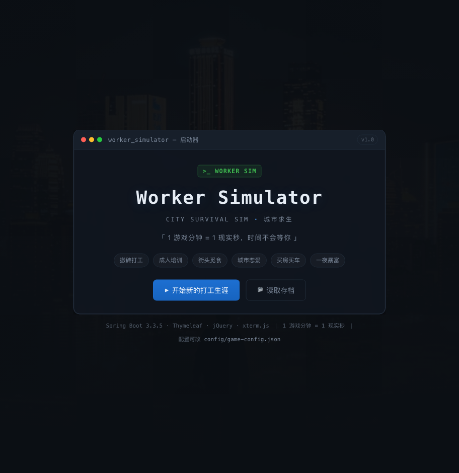
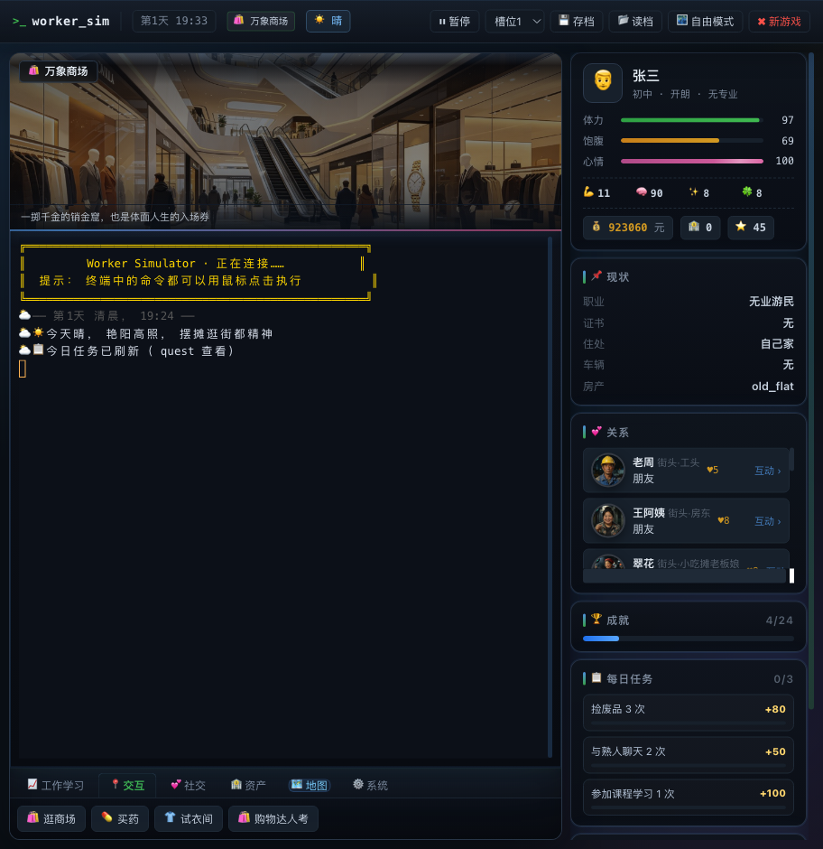
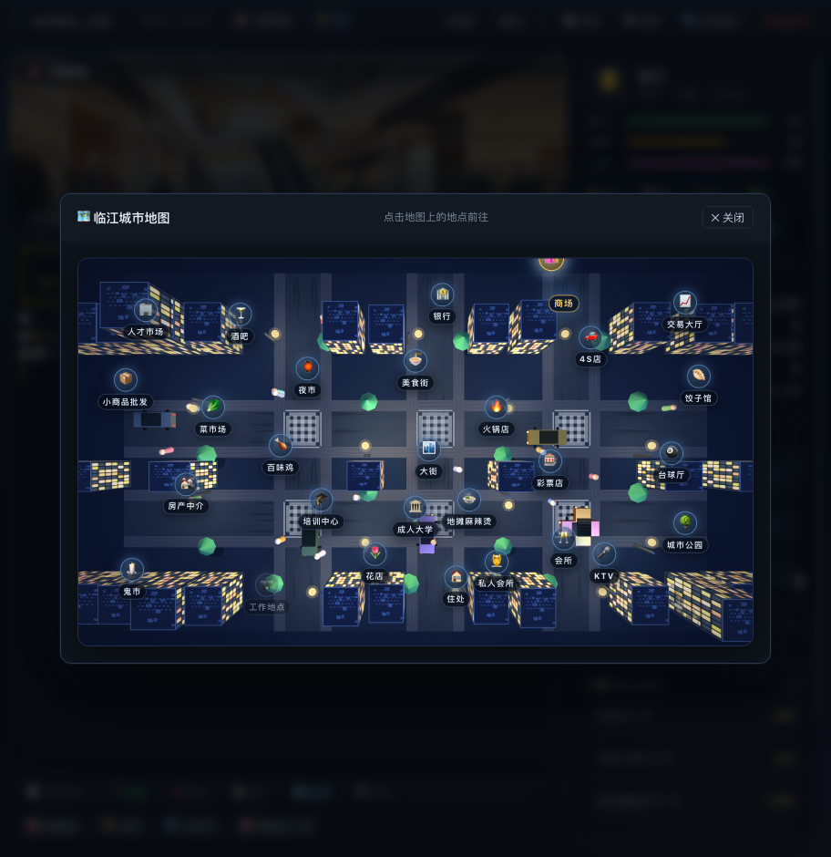
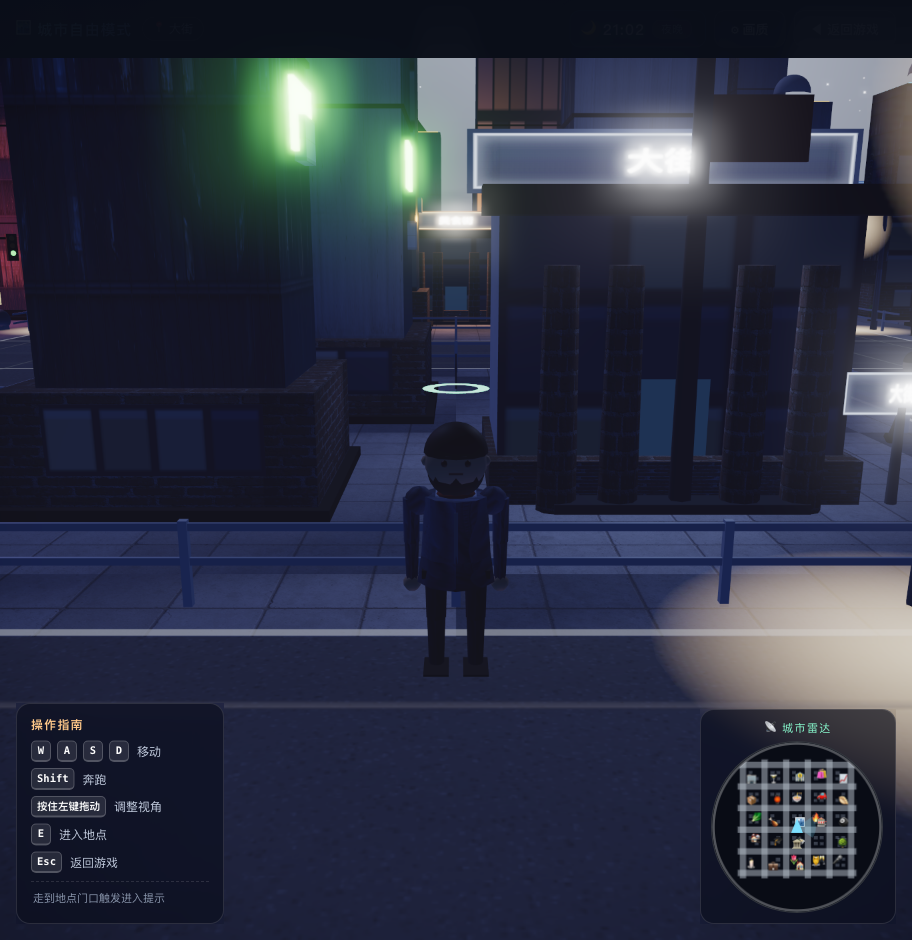
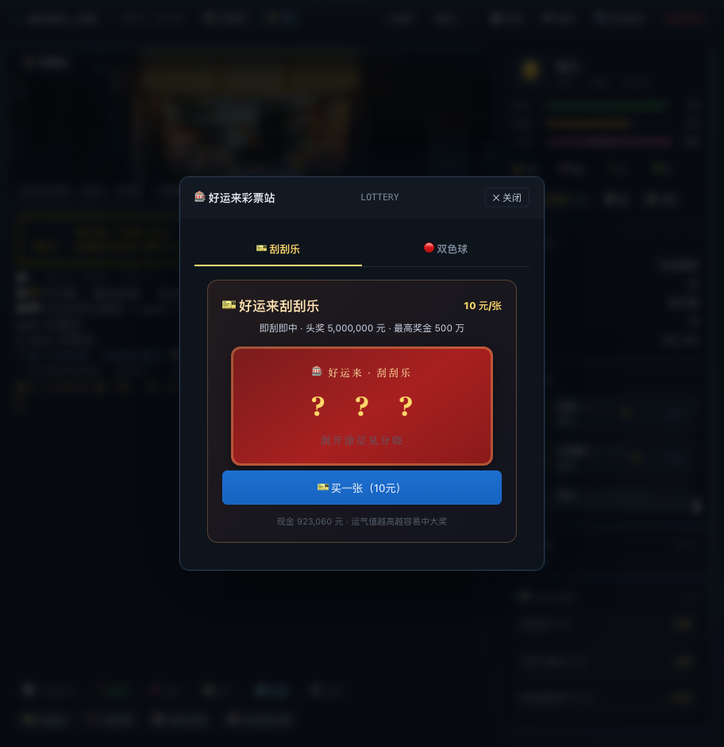
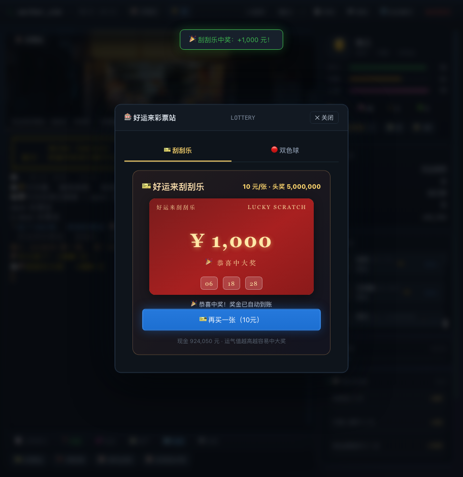
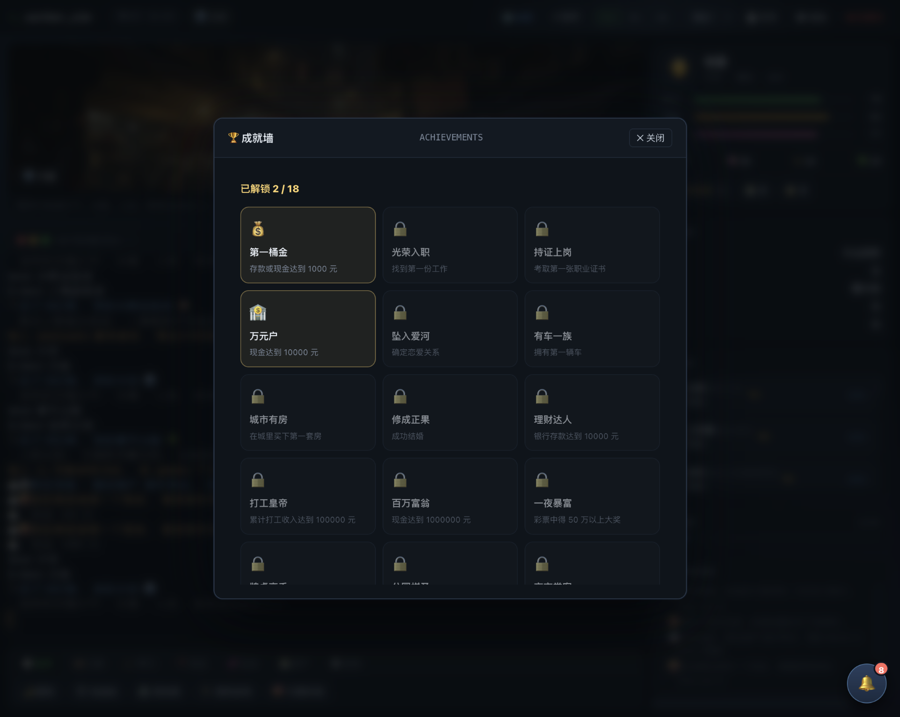

# 🧱 打工人模拟器 · 城市求生

> 终端风格文字冒险 + 模拟经营游戏。你从乡下揣着 500 块钱来到大城市，
> 搬砖、送外卖、学技能、考证书、恋爱结婚、买房买车……从一无所有，到在这座城市活下去。
> 现已加入 **🌃 自由模式**：第三人称 3D 城市漫游，在霓虹街道上自由行走。



> 深色终端风启动器，一键开始打工生涯或读取存档。

## ✨ 功能特性

| 模块 | 说明 |
|---|---|
| 🧑‍💼 角色创建 | 姓名 / 性别 / 性格 / 学历 / 专业，四维技能点分配（体力、智力、魅力、运气） |
| 🏗️ 一般职业 | 发传单、搬砖、外卖骑手、快递员、售楼、会所迎宾、保安、服务员、收银员、服装店员等 |
| 🎓 成人培训 | 会计、计算机、厨师、电工、焊工、美容美发 6 门课程，学满熟练度 → 交费考试 → 拿证书 |
| 💼 特殊职业 | 初级会计、程序员、电工、焊工、厨师、会计主管等，需对应证书，薪资碾压普通职业 |
| 🗑️ 捡废品 / 🏪 摆地摊 | 街头求生小收入，运气与魅力加持 |
| 🍜 饮食系统 | 路边摊、沙县、串串、火锅、自己做饭……恢复饱腹/体力/心情 |
| 🏠 住宿系统 | 睡大街（有风险）、桥洞、日租房、青旅、城中村单间（月租）、公寓 |
| 💕 社交恋爱 | 大街陌生人 / 工作同事，聊天、请客、送礼加好感；30 朋友 → 50 暧昧 → 60 表白恋爱 → 90 求婚结婚 |
| 🛍️ 商场购物 | 衣服 / 裤子 / 手表 / 手机 / 宠物猫，提升魅力与声望；部分工作对着装有硬性要求 |
| 🏡 资产系统 | 多套房源 + 多款车型，买房买车涨声望、解锁免费住宿、配送提效、商铺日租 |
| 🏦 银行存款 | 现金可存银行吃日息，支持定期理财 |
| 📈 股票投资 | 交易大厅实时行情，低买高卖赚取差价 |
| 🎫 娱乐 | 刮刮乐、双色球（每日开奖，头奖 500 万）、台球、KTV、公园赌局 |
| 🌃 夜市 / 🕯️ 鬼市 | 华灯初上的夜市烟火气，凌晨出没的鬼市古董淘宝 |
| 🌆 随机事件 | 捡钱包、被偷、暴雨、老乡请客、城管驱赶、临时加班……运气属性影响事件走向 |
| 🏆 成就系统 | 第一桶金、持证上岗、有车有房、修成正果、一夜暴富……多项成就 |
| ⏱️ 时间系统 | **1 游戏分钟 = 1 现实秒**；支持暂停 / 1× / 2× / 4× 倍速，昼夜循环 |
| 💾 存档 | 3 个手动槽位 + 每日清晨自动存档，JSON 格式可备份 |



> 终端模式主界面：左侧场景图 + 终端窗口，右侧角色状态、关系、成就与每日任务，顶部一排快捷按钮。



> 俯视城市地图，28 个地点随日夜变换灯光，点击即可前往。

## 🌃 自由模式（3D 城市漫游）

在终端游戏页点击 **「🌃 自由模式」** 按钮，即可进入基于 Three.js 的第三人称 3D 城市，用脚步丈量这座霓虹都市：

- **🚶 自由移动**：WASD 行走，鼠标拖拽旋转视角，靠近地点按 `E` 进入
- **🗺️ 完整城市**：28 个地点与终端模式地图一一对应——人才市场、商场、银行、4S 店、美食街、夜市、鬼市、公园、KTV、私人会所……
- **🌗 昼夜同步**：进入自由模式时自动对齐终端游戏时间，日出日落、街灯亮起与终端模式完全一致
- **🏙️ 高仿真画质**：AI 生成的街景贴图、摩天楼、路灯、行道树、车辆，GPU 自适应画质，低配自动降级
- **🧭 小地图雷达**：右上角雷达显示附近地点与自己的朝向，不会迷路
- **🚪 一键返回**：逛够了随时切回终端模式继续打工，时间与金钱完全互通

> 自由模式是「放松漫游」视角：你可以在无人的深夜街头漫步、在江边看月亮、从街尾走到街尾；想认真打拼时，回到终端模式继续搬砖。



> 深夜 21 点的 3D 城市：小人站在霓虹街道上，左下角操作指南，右下角雷达小地图，街灯与月光交织。

## 🛠️ 技术架构

- **后端**：Spring Boot 3.3.5（Java 21+）+ Jackson
- **模板**：Thymeleaf
- **终端模式**：jQuery 3.7.1 + xterm.js 5.3.0（终端渲染）+ FitAddon
- **自由模式**：Three.js（WebGL 第三人称 3D）+ AI 生成贴图
- **配置**：游戏数值全部外置于 JSON 文件（`config/game-config.json`），改完重启即生效
- **存档**：运行时写入 `saves/` 目录（JSON）



> 好运来彩票站：刮刮乐与双色球双 Tab，10 元一张试试手气。

## 🚀 运行方式

### 方式一：源码运行（推荐）

```bash
cd worker-simulation
./mvnw spring-boot:run
```

### 方式二：打包运行

```bash
cd worker-simulation
./mvnw -DskipTests package
java -jar target/worker-simulator-1.0.0.jar
```

启动后浏览器打开：**http://localhost:8897**（默认端口）

### 自定义配置启动

```bash
java -jar target/worker-simulator-1.0.0.jar \
  --game.start-money=30000 \
  --server.port=9090
```



> 红色刮刮卡样式，一键刮开——运气值越高越容易中大奖，头奖 500 万。

## 🎮 玩法速览

1. **创建角色** → 选学历（决定技能点总量）、性格、专业，分配四维技能点
2. **开局求生**：去 `人才市场` 找份工作（`jobs` / `sign 编号`），或在大街 `scrap` 捡废品
3. **攒钱路线**：打工 → 吃饭 → 睡觉，攒够学费后去 `培训中心` 学技能、考证书
4. **跃迁**：拿证书入职特殊职业，继续攒钱
5. **人生巅峰**：商场置装提升魅力 → 社交恋爱结婚 → 存钱买房买车 → 股票 / 彩票暴富
6. **放松一下**：点「自由模式」在 3D 城市里散散步，深夜街头看月亮
7. 随时 `save` / `load`，`pause` 暂停，`speed 2/4` 加速

### 常用指令

```
help           查看全部指令       status         查看状态
move 人才市场  前往地点           jobs           招聘信息
sign 3         入职(按编号)       resign         辞职
work 8         打工8小时          scrap          捡废品
stall          摆地摊             train 1        学习课程
exam 1         结业考试           eat            吃饭
sleep          睡觉               housing        选择住处
shop / buy 1   商场购物           assets         查看资产
buyhouse 1     买房               buycar 1       买车
bank 500       存钱               withdraw 100   取钱
social         附近的人           talk 1         聊天
treat 1        请客               gift 1         送礼
confess 1      表白               propose 1      求婚
scratch 3      刮刮乐             lottery buy 5  买双色球
achievements   成就               save 1         存档
load 1         读档               pause/resume   暂停/继续
speed 4        4倍速
```



## 📁 目录结构

```
worker-simulation/
├── pom.xml                     # Maven 配置（Spring Boot 3.3.5）
├── config/game-config.json     # ★ 外部游戏配置（职业/课程/物价/事件/成就）
├── saves/                      # 运行时存档目录（JSON）
├── docs/
│   ├── Worker-Simulator-游戏文档.md   # 完整游戏设计文档
│   └── screens/                       # 游戏截图
├── src/main/java/com/cityworker/sim/
│   ├── CityWorkerApplication.java
│   ├── controller/             # 页面路由 + 游戏 API
│   ├── service/                 # 游戏引擎（时间/指令/职业/培训/社交/彩票/存档）
│   ├── model/                   # 状态模型与配置模型
│   └── util/                    # 工具类
└── src/main/resources/
    ├── application.yml         # 端口/存档目录/初始参数
    ├── templates/              # index / game / free（自由模式 3D 页）
    └── static/                 # css / js（app.js / free.js 3D）/ img（AI 插图）/ vendor
```

## ⚙️ 数值平衡说明

- 时间：1 游戏分钟 = 1 现实秒；一天 1440 分钟 = 24 分钟现实时间
- 开局：500 元现金，体力 100 / 饱腹 80 / 心情 70
- 一般职业时薪：8~16 元/小时；特殊职业 20~44 元/小时（证书是最大分水岭）
- 培训：学费 1800~3000 元，智力与专业影响学习速度，通过率与智力/熟练度挂钩
- 所有数值均可在 `config/game-config.json` 中调整（重启生效）

## 📝 已知说明

- 单机单人游戏，状态保存在服务端内存，刷新页面不丢档（每日自动存档兜底）
- 若修改了外部配置文件，需重启服务生效
- 头像与场景插图为 AI 生成，位于 `src/main/resources/static/img/`
- 自由模式（3D）需要支持 WebGL 的现代浏览器

## 📄 许可证

本项目基于 **MIT License** 开源 —— 可自由使用、修改、分发与商用，仅需保留版权声明。详见 [LICENSE](LICENSE)。
