# Worker Simulator · 打工人模拟器 游戏文档

> 版本 v1.0 · 从一无所有的乡下人，到在城市立足的打工人 —— 你的城市人生，从这里开始。

---

## 目录

- [一、游戏概述](#一游戏概述)
- [二、快速开始](#二快速开始)
- [三、角色创建](#三角色创建)
- [四、核心系统：时间与状态](#四核心系统时间与状态)
- [五、城市地图与地点](#五城市地图与地点)
- [六、职业系统](#六职业系统)
- [七、成人技能培训](#七成人技能培训)
- [八、经济系统](#八经济系统)
- [九、购物与换装](#九购物与换装)
- [十、社交与感情](#十社交与感情)
- [十一、手机模块](#十一手机模块)
- [十二、资产与创业](#十二资产与创业)
- [十三、成就系统](#十三成就系统)
- [十四、系统功能](#十四系统功能)
- [十五、外部配置说明](#十五外部配置说明)
- [十六、玩法攻略建议](#十六玩法攻略建议)

---

## 一、游戏概述

**Worker Simulator（打工人模拟器）** 是一款终端 + 图形界面双模驱动的打工人人生模拟游戏。你扮演一名从乡下进城打工的年轻人，从睡大街、捡废品开始，通过打工、培训考证、投资理财、社交婚恋，一步步在城市里立足，最终买房买车、创业当老板。

### 技术架构

| 组件 | 技术 |
|---|---|
| 后端 | Spring Boot 3.3.5（Java 21） |
| 模板引擎 | Thymeleaf |
| 前端 | jQuery + 原生 JS |
| 终端 | xterm.js（支持鼠标点击命令） |
| 配置 | 外部 JSON 文件（`config/game-config.json`） |
| 端口 | 8897 |

### 游戏特色

- **双模操作**：所有功能既可用图形界面（弹窗/按钮）操作，也可用终端命令行执行
- **真实时间流动**：1 游戏分钟 = 1 现实秒，可暂停、可倍速
- **完整成长线**：从搬砖工 → 白领 → 金领 → 老板
- **高随机性**：随机事件、刮刮乐、彩票、股市、赌局、鬼市古董
- **深度社交**：NPC 好感度、恋爱、结婚、离婚
- **全场景 UI 化**：25+ 地图地点，全部支持弹窗交互

---

## 二、快速开始

### 环境要求

- JDK 21+
- Maven 3.9+

### 启动方式

```bash
# 1. 打包（前端资源在 jar 内，修改后必须重新打包）
mvn -B -q -DskipTests package

# 2. 启动（默认端口 8897）
java -jar target/worker-simulator-1.0.0.jar --game.start-money=30000

# 3. 浏览器访问
http://localhost:8897
```

### 游戏配置

游戏所有数值均位于 `config/game-config.json`（源码内同路径也有一份，改任一份需同步另一份），包括：学历、性格、专业、地点、职业、课程、食物、住房、商品、车辆、房产、彩票、股票、生意、NPC、成就、批发商品等。

---

## 三、角色创建

进入游戏后通过 **5 步向导** 创建角色，每一步都有图形化选择界面：

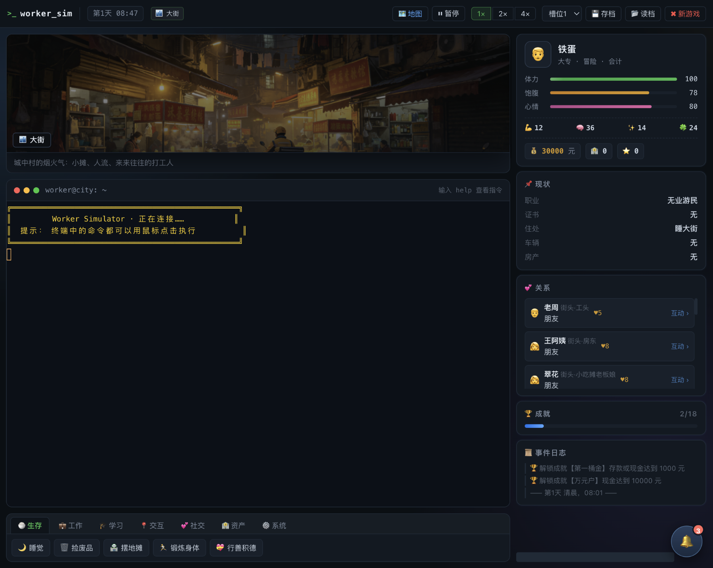

### 1. 姓名与性别

输入姓名，选择性别（男性 / 女性）。性别会影响后续社交对象的性别倾向与部分剧情。

### 2. 性格（5 选 1）

| 性格 | 天赋加成 | 适合路线 |
|---|---|---|
| 开朗 | 魅力+3，社交效率+15% | 销售、服务行业 |
| 稳重 | 体力+3，工作收入+10% | 稳定打工流 |
| 内向 | 智力+3，学习效率+10%，魅力-1 | 考证、技术流 |
| 冒险 | 运气+4，风险收益+15%，体力+1 | 彩票、赌局、摆摊 |
| 吃苦耐劳 | 体力+3，体力上限+3 | 搬砖、体力流 |

### 3. 学历（5 选 1）

学历决定初始属性点与基础属性：小学（30 点）、初中（40 点）、高中（50 点）、大专（60 点）、本科（70 点）。学历越高，智力起点越高、可分配点数越多。

### 4. 专业（5 选 1）

无专业、计算机、会计、烹饪、机械。选择对应专业后，学习同名课程效率翻倍（如选「会计」专业，学会计课程事半功倍）。

### 5. 技能点分配

将剩余点数自由分配到 **体力、智力、魅力、运气** 四项属性，即时预览最终面板。

> 四大属性：**体力**（干活本钱，影响体力消耗与搬砖收入）、**智力**（学习根基，决定培训效率与考试通过率）、**魅力**（社交与销售敲门砖，影响好感度与部分职业）、**运气**（捡废品、刮刮乐、彩票与随机事件全看它）。

---

## 四、核心系统：时间与状态

### 时间系统

- **1 游戏分钟 = 1 现实秒**，从第 1 天 08:00 开始
- 体力、饱腹、心情随时间自然缓慢消耗；工作、移动等行为会加速消耗
- 每天清晨自动结算：存款利息（日息 0.05%）、住房租金、生意经营、随机事件

### 状态面板

| 状态 | 作用 |
|---|---|
| 体力 💪 | 干活/工作的本钱，归零会生病；睡觉恢复 |
| 饱腹 🍚 | 通过吃饭恢复，归零持续扣体力 |
| 心情 😊 | 影响社交效率与工作效率；娱乐、消费、撸猫恢复 |
| 健康 | 感冒等会降低工作效率，商场买药恢复 |
| 金钱 / 存款 | 现金随身的钱，存款存银行吃利息 |
| 声望 | 穿戴、买车买房、消费积累，部分高阶职业要求 |
| 魅力（加成后） | 职业技能要求与社交好感度依据（含穿戴加成） |

### 随机事件

在街头活动会触发随机事件：捡到钱包、被偷、同乡请客、暴雨淋湿、流浪猫安慰、老板多结辛苦费、生病买药、培训老师开小灶……运气值影响事件好坏概率。

---

## 五、城市地图与地点

点击顶栏「🗺 地图」打开**临江城市地图**，地图按街区网格排布，点击任意地点即可前往。

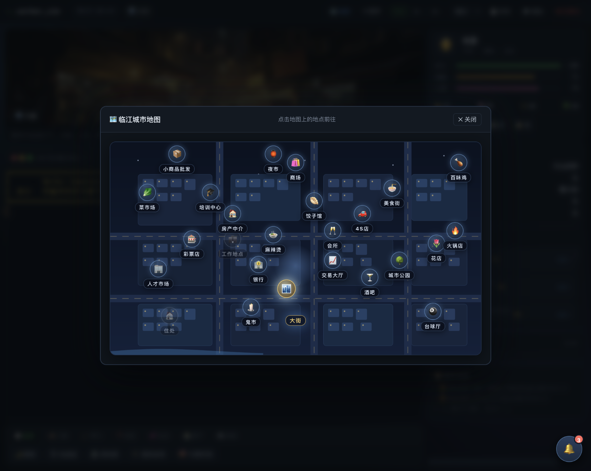

全城 **25 个地点**，覆盖衣食住行与暴富通道：

| 类别 | 地点 |
|---|---|
| 生活 | 大街、住处、美食街、菜市场、百味鸡、地摊麻辣烫、饺子馆、火锅店 |
| 娱乐 | 花店、酒吧、台球厅、会所、城市公园、夜市、鬼市 |
| 成长 | 人才市场、技能培训中心、小商品批发 |
| 财富 | 银行、交易大厅（股市）、彩票店 |
| 置业 | 4S 店、房产中介、万象商场 |
| 工作 | 工作地点 |

**地点场景图**：每个地点都有专属插画配图，鼠标移入图片变亮、移出带阴影模糊效果，营造沉浸感。

### 深夜特殊地点

- **夜市**（夜间）：套圈游戏、章鱼小丸子、铁板鱿鱼、烤冷面……
- **鬼市**（凌晨）：神秘商贩，淘古董（赌眼力，可能一夜暴富也可能血本无归）、求签看运势

---

## 六、职业系统

在「人才市场」查看招聘信息（`jobs`），去「工作地点」上班（`work 8`）。共 **25 种职业**，分三个梯队：

### 第一梯队：一般职业（无学历技能要求，但可能有魅力/着装要求）

| 职业 | 日薪 | 要求 | 成长属性 |
|---|---|---|---|
| 发传单 | 64 | 无 | 魅力 |
| 保洁员 | 72 | 无 | 体力 |
| 餐厅服务员 | 80 | 魅力≥25 | 魅力 |
| 超市收银员 | 88 | 智力≥35 | 智力 |
| 搬砖工人 | 88 | 体力≥45 | 体力 |
| 服装店店员 | 96 | 魅力≥40 + 穿商务衬衫 | 魅力 |
| 快递员 | 100 | 体力≥40 | 体力 |
| 保安 | 100 | 体力≥50 | 体力 |
| 咖啡店店员 | 110 | 魅力≥35 + 穿商务衬衫 | 魅力 |
| 外卖骑手 | 112 | 体力≥45 | 体力 |
| 会所迎宾员 | 120 | 魅力≥50 + 声望≥5 + 穿西装 | 魅力 |
| 售楼置业顾问 | 128 | 魅力≥50 + 声望≥10 + 穿西装 | 魅力 |
| 4S店销售顾问 | 145 | 魅力≥56 + 声望≥12 + 穿西装 | 魅力 |

> 职业晋升路上注意：**着装要求需先穿戴**（背包穿戴/`wear` 命令），属性按穿戴后加成判定。

### 第二梯队：特殊职业（需职业证书）

| 职业 | 日薪 | 证书要求 |
|---|---|---|
| 美容师 | 160 | 美容师证 |
| 厨师 | 180 | 中式烹调师证 |
| 初级会计 | 200 | 会计从业资格证 |
| 电工 | 220 | 电工操作证 |
| 焊工 | 250 | 焊工证 |
| 程序员 | 300 | 计算机应用技术证 |
| 西餐主厨 | 300 | 中式烹调师证 |
| 会计主管 | 350 | 会计证 + 声望≥25 |
| 网络安全工程师 | 380 | 计算机证 + 声望≥15 |

### 第三梯队：高阶职业（需多证书叠加）

| 职业 | 日薪 | 证书要求 |
|---|---|---|
| 注册会计师 | 480 | 会计证 + 计算机证 |
| 证券分析师 | 430 | 会计证 + 计算机证 |
| 全栈工程师 | 500 | 计算机证 + 电工证 |

### 职业成长

每个职业会持续成长对应属性（如搬砖涨体力、会计涨智力、销售涨魅力），打工收入累计还能解锁「打工皇帝」成就。职业路径设计为：**先干一般职业攒钱攒属性 → 培训考证 → 换特殊/高阶职业 → 收入起飞**。

---

## 七、成人技能培训

「技能培训中心」提供 6 门课程：**会计、厨师、美容美发、电工、计算机、焊工**。

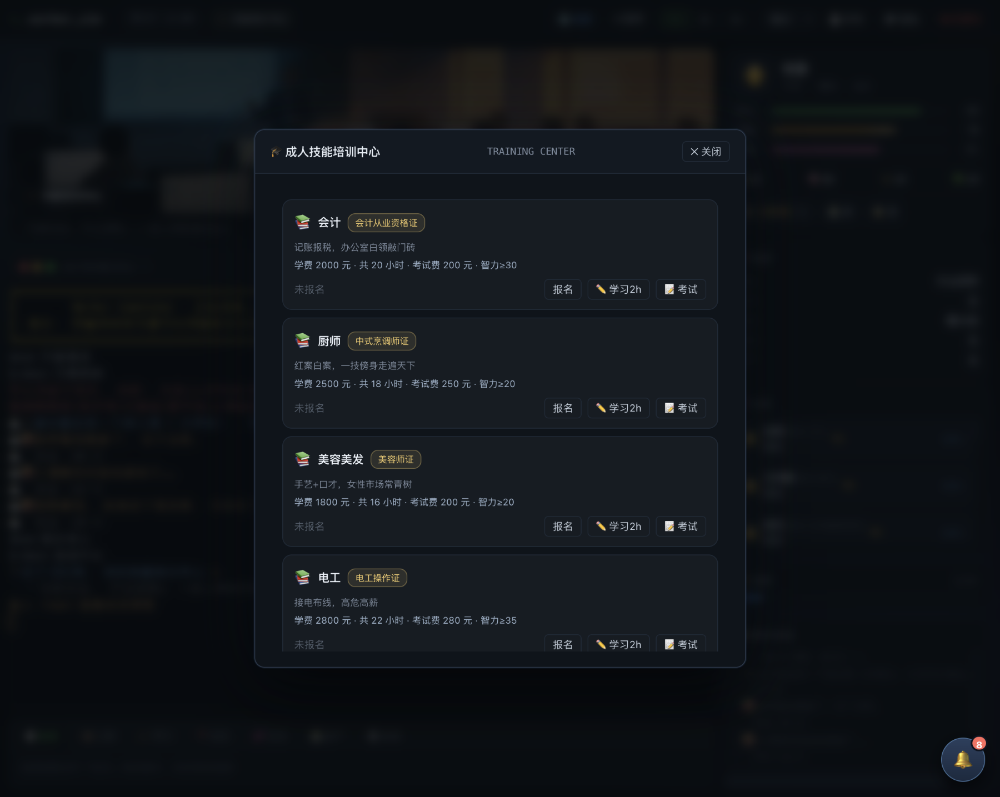

### 培训流程

1. **报名**：支付学费（1800~3000 元），报名后记录学习进度
2. **学习**：每次学习 2 小时，通过 **图形化答题弹窗** 作答 1 道题（判断题/选择题，题目简单），答对则本节课学习成功、熟练度 +1
3. **考试**：达到课时后参加结业考试，**需答对全部题目**才能拿证
4. **拿证**：获得对应职业证书（会计从业资格证、中式烹调师证、电工操作证……），可查看「证书墙」；一个人可学多门课程、持多张证书

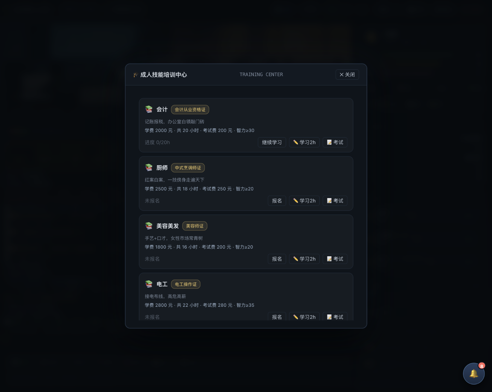

> 每个职业的证书要求对应课程证书 id（如「初级会计」要求 `accounting` 证书），高阶职业需多证叠加。选对专业（如会计专业）学同名课程进度更快。

---

## 八、经济系统

从零开始赚第一桶金，路径非常丰富：

### 1. 打工赚工资（最稳）

去「工作地点」上班，日薪从 64 到 500 不等，按职业档次提升。

### 2. 捡废品（零成本起步）

在大街翻垃圾桶（`scrap`），收益不高但零门槛，运气加成。

### 3. 摆地摊（小生意）

去「小商品批发」进货（袜子、手机壳、数据线、发光玩具、头绳、钥匙扣……16 种商品），再到大街摆摊吆喝，赚差价。天气、人群会影响销量。

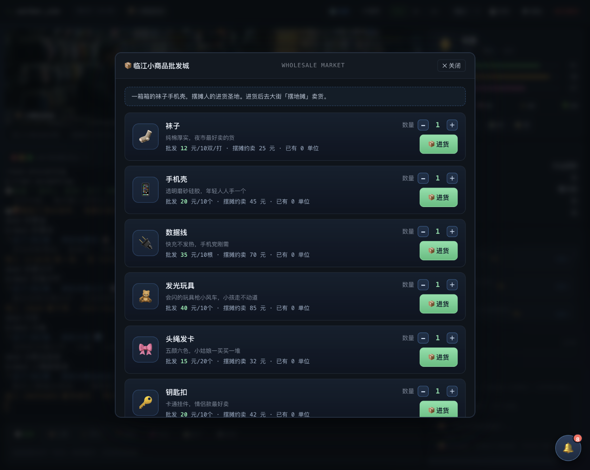

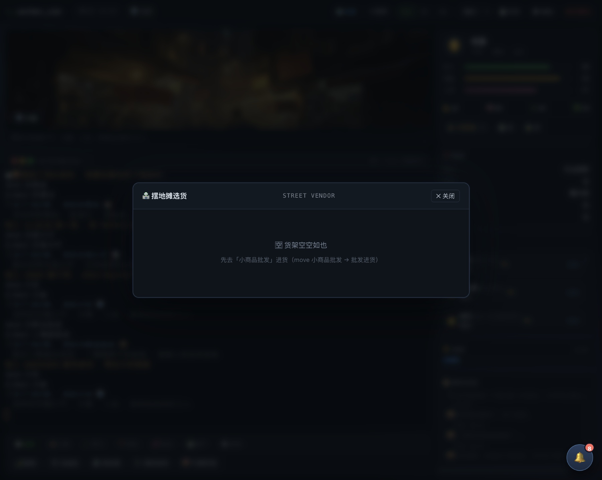

### 4. 刮刮乐（好运来彩票站）

10 元/张，即刮即中，最高可连刮 20 张；**头奖 5,000,000 元**，中奖率 40%，大奖概率 30%，运气值越高越容易中奖。

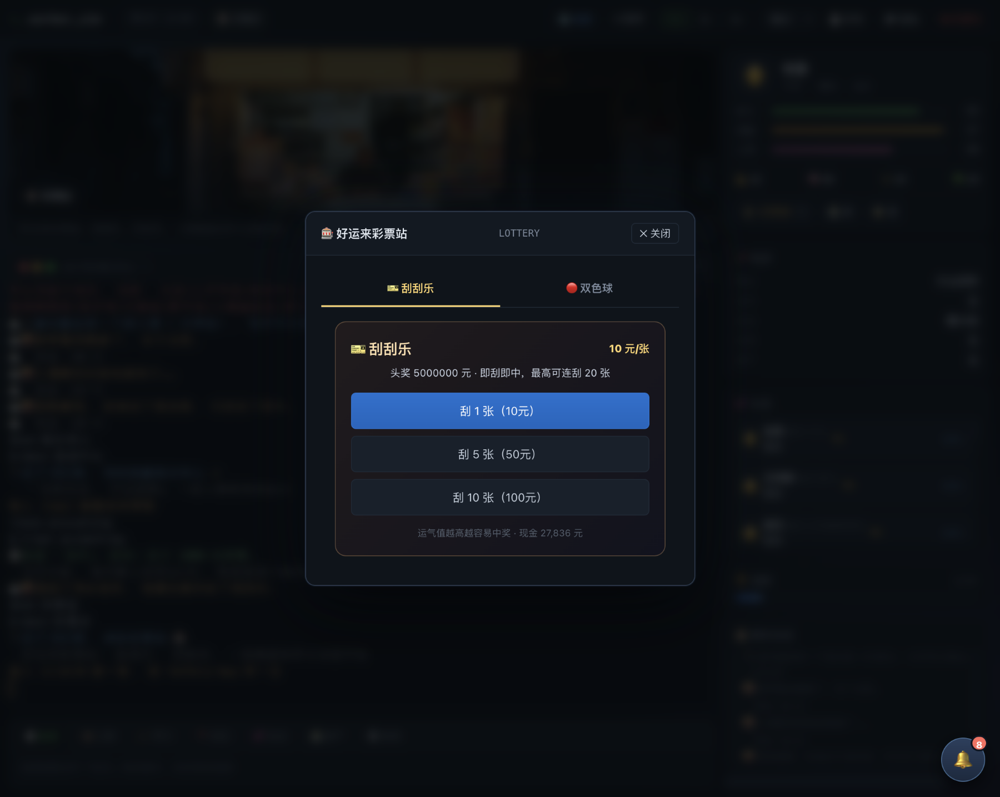

### 5. 双色球（好运来彩票站）

2 元/注，每天 21:30 开奖，6+1 全中头奖 5,000,000 元，可守号、可机选。

### 6. 股票投资（临江交易大厅）

6 支股票：万象科技、草原奶茶、城市外卖、恒达地产、新能电力、网红传媒，红涨绿跌实时行情，K 线走势图，1 手 = 100 股，买卖收手续费。低买高卖，暴富通道之一。

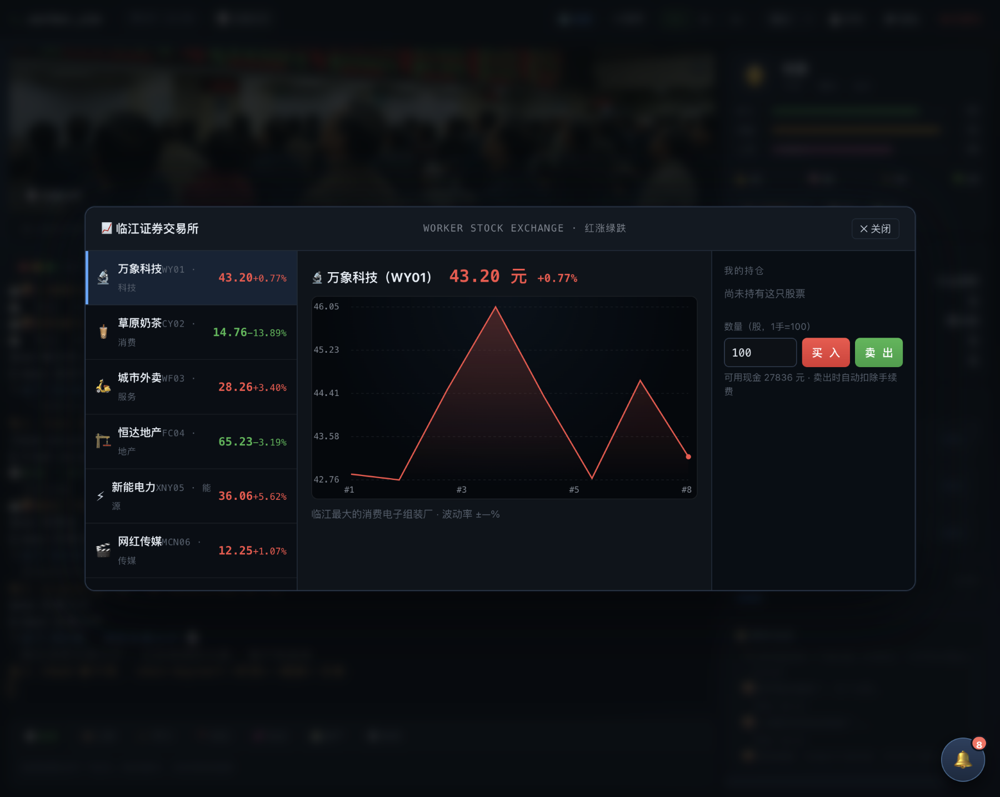

### 7. 公园赌局（城市公园）

- **21 点**：与公园牌友对赌，爆了算输，庄家 17 点停牌
- **五子棋**：与棋友对弈，赢棋加好感、输棋扣心情

### 8. 夜市/鬼市

套圈（20 元 3 圈碰运气）、淘古董（50 元一把，赌眼力）。

### 9. 银行存钱

日息 0.05%，存 10,000 元每天 +5 元，每天清晨自动结算，积少成多。

### 10. 睡觉恢复

「找住处」选择住宿：睡大街（免费但有风险）、桥洞、日租房（40 元/晚）、青年旅社（60 元/晚）、城中村单间（月租 800）、单身公寓（月租 1500）。

---

## 九、购物与换装

「万象商场」29 种商品，分衣服/裤子/鞋子/手表/饰品/数码/宠物/健康等类别。

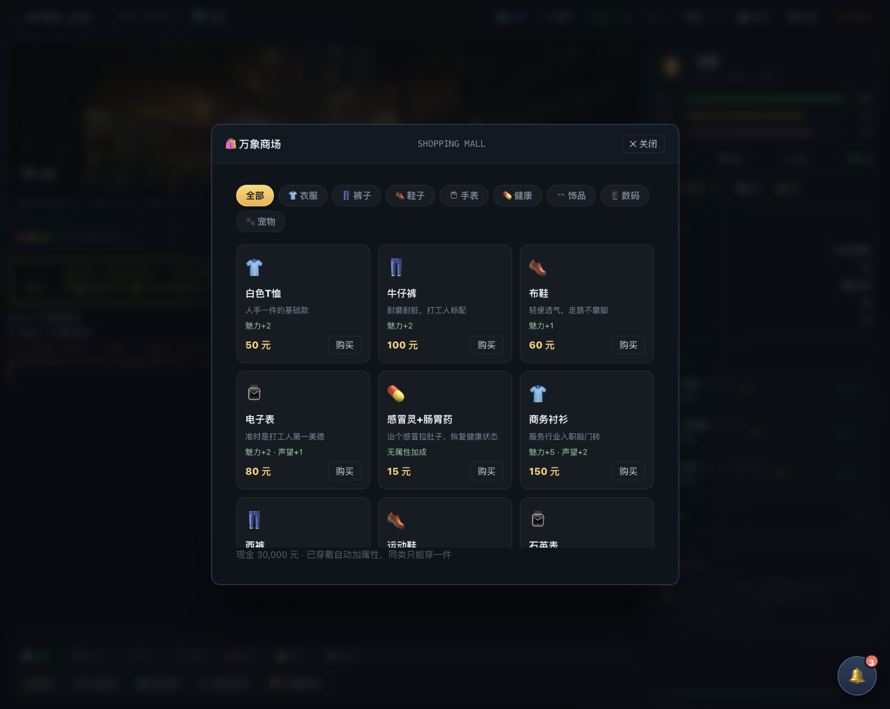

### 商品与属性

| 品类 | 代表商品 | 加成 |
|---|---|---|
| 衣服 | 白T恤/商务衬衫/西装/皮夹克/晚礼服/名牌西装 | 魅力+2~25 |
| 裤子 | 牛仔裤/西裤/休闲西裤 | 魅力+2~8 |
| 鞋子 | 布鞋/运动鞋/皮鞋/名牌皮鞋 | 魅力+1~16 |
| 手表 | 电子表/石英表/机械表/劳力士 | 魅力+2~25，声望+1~22 |
| 饰品 | 太阳镜/名牌皮带/金链子 | 魅力+3~10 |
| 数码 | 二手手机/智能手机/平板/笔记本 | 社交效率+10%~20% |
| 宠物 | 田园猫/小狗/布偶猫 | 每天+心情 |
| 健康 | 感冒灵+肠胃药 | 恢复健康状态 |

### 换装规则

- **同类别只能穿戴一件**（如都是衣服只能穿一件），穿新装备自动换下同类旧装备
- 「我的背包」弹窗支持图形化穿戴/卸下，终端 `bag` / `wear` / `takeoff` 命令同样可用
- 职业着装要求按**穿戴后**属性判定（如售楼置业顾问需穿西装且魅力≥50）

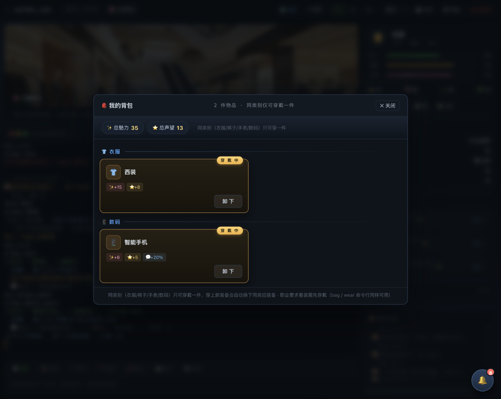

---

## 十、社交与感情

「大街」与「工作地点」会出现随机 NPC（外卖小哥、服装店员、会计、护士、小主播、程序员、厨师、房产销售、大学生……），名字随机生成（王强、李娜、张梦琪……）。

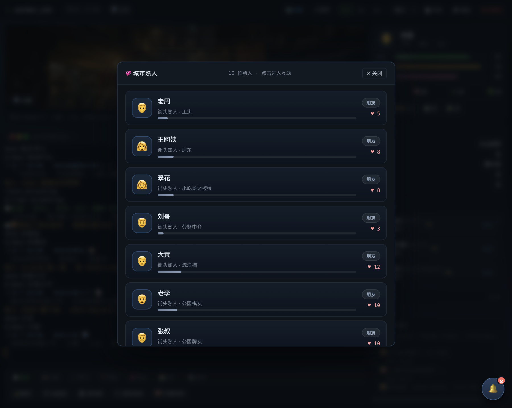

### 互动方式

- **聊天**：增加好感度
- **请客/送礼**：好感度增长更快
- **表白**：好感度达到阈值可表白成为恋人
- **求婚**：恋爱后可求婚结婚
- **离婚**：婚后可在关系菜单操作（好感度下降）

### 好感度阶段

好感度（♥）随互动提升：陌生人 → 朋友 → 熟人 → 恋人 → 夫妻。关系显示在右侧面板（如「老周 · 街头·工头 · ♥5」），每条关系都有独立交互弹窗（聊天/请客/送礼/表白/离婚等按钮）。

### 商铺 NPC

在花店、酒吧、台球厅、会所、餐饮店等地点消费时，会与商铺 NPC 互动，每次消费提升好感度。商铺 NPC 有男有女，说不定能发展一段「顾客与老板娘」的故事。

---

## 十一、手机模块

在商场购买手机（二手智能手机 500 元 / 智能手机 1500 元）后解锁「📱 手机」：

- **聊天**：接收房东、工友、妈妈的微信消息，可回复互动（心情+2）
- **短视频**：刷短视频消磨时间（心情加成）
- **点外卖**：动动手指，饭到门口（补充饱腹）


---

## 十二、资产与创业

### 资产总览

「资产总览」实时统计总资产 = 现金 + 存款 + 生意估值，分栏展示现金/存款、房产、车辆、生意明细。

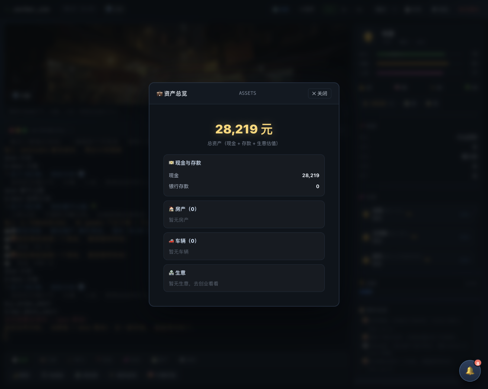

### 购房（房产中介）

7 档房产：城中村小产权房（5 万）→ 市区老破小（30 万）→ 街边小商铺（40 万，每天被动收租 10 元）→ 电梯公寓（80 万）→ 电梯两居室（150 万）→ 郊区别墅（300 万）→ 江景大平层（500 万，每天收租 30 元）。买房涨声望，还能解锁「城市有房」成就。

### 买车（4S 店）

10 款车：电动车（2000，配送+30%）→ 三轮车（4000）→ 摩托车（8000，配送+35%）→ 面包车（1.5 万，配送+40%）→ 二手轿车（5 万）→ 合资新车（15 万）→ 中级轿车（30 万）→ 货运卡车（40 万，配送+50%）→ 豪华轿车（80 万，社交+10%）→ 跑车（200 万，社交+15%）。4S 店弹窗支持「买车/卖车」tab 切换，卖车 6 折回收。

### 创业（从打工人到老板）

5 档生意：烧烤摊（2000，日入 80）→ 奶茶店（8000，日入 200）→ 面馆（2 万，日入 380）→ 花店（5 万，日入 760）→ 深夜食堂（12 万，日入 1500）。开店需声望达标，营业消耗体力，可升级扩大规模。

### 炒股

见「八、经济系统」第 6 条。

---

## 十三、成就系统

全 **18 项成就**，覆盖各玩法：

| 成就 | 达成条件 |
|---|---|
| 第一桶金 / 万元户 / 百万富翁 | 现金达标 |
| 光荣入职 / 持证上岗 / 打工皇帝 | 就业/考证/累计收入 |
| 坠入爱河 / 修成正果 | 恋爱/结婚 |
| 有车一族 / 城市有房 / 理财达人 | 买车/买房/存款 |
| 一夜暴富 | 彩票中 50 万+ |
| 牌桌高手 / 公园棋圣 | 21 点/五子棋连胜 |
| 夜市常客 / 鬼市探险家 | 夜市/鬼市消费 |
| 证书达人 | 考取 3 张证书 |
| 新生 | 开启新周目 |


---

## 十四、系统功能

### 顶栏控制

- **🗺 地图**：打开城市地图跳转
- **⏸ 暂停/继续**：冻结游戏时间
- **1×/2×/4×**：游戏倍速（1 游戏分钟 = 1/0.5/0.25 现实秒）
- **槽位 1/2/3 + 存档/读档**：三槽位存档
- **✖ 新游戏**：新周目（继承 30% 现金、车辆、证书与关系）

### 命令面板（底部 7 大 Tab）

| Tab | 功能 |
|---|---|
| 🍚 生存 | 睡觉、捡废品、摆地摊、锻炼身体、行善积德 |
| 💼 工作 | 招聘信息、去上班 |
| 🎓 学习 | 培训课程、读书自习、证书墙 |
| 📍 交互 | 按当前地点显示专属操作（商场购物、银行存取款、4S 店买车卖车、彩票、赌局……） |
| 💕 社交 | 附近的人、熟人互动 |
| 🏦 资产 | 背包、创业开店、资产总览、交易大厅 |
| ⚙️ 系统 | 帮助、状态、成就、手机、暂停、倍速、存档、新周目 |

> 所有按钮执行后均有 toast 结果提示；终端命令同样支持鼠标点击执行。

### 终端命令行（xterm.js）

```text
help                查看所有指令
status              查看完整属性
move 大街           前往地点（地点名见地图）
jobs / sign 1       招聘信息 / 入职
work 8              打工 8 小时
train / quiz       培训报名 / 答题
exam                结业考试
eat / sleep         吃饭 / 睡觉
scrap / stall       捡废品 / 摆地摊
shop / buy 1        商场购物
bag / wear 2        背包 / 穿戴
assets              资产总览
buycar 1 / sellcar  买车 / 卖车
buyhouse 1          买房
bank / withdraw     存取款
scratch / lottery   刮刮乐 / 双色球
stock buy WY01 100  买股票
bj / gomoku         21点 / 五子棋
social / talk 1     社交 / 聊天
save / load         存档 / 读档
pause / speed 2     暂停 / 倍速
```

---

## 十五、外部配置说明

所有游戏数值通过 `config/game-config.json` 配置，主要模块：

| 配置块 | 内容 |
|---|---|
| `education` / `personalities` / `majors` | 创建角色三要素 |
| `attributes` | 四大属性定义 |
| `locations` | 25 个地图地点（含配图） |
| `jobs` | 25 种职业与入职要求 |
| `courses` | 6 门培训课程与题库 |
| `foods` | 48 种食物/消费品 |
| `housing` | 6 档住宿 |
| `mall` | 29 种商场商品 |
| `cars` | 10 款车辆 |
| `realestate` | 7 档房产 |
| `scratch` / `lottery` | 刮刮乐与双色球规则 |
| `stocks` | 6 支股票 |
| `businesses` | 5 档创业生意 |
| `wholesale` | 16 种批发商品 |
| `achievements` | 18 项成就 |
| `events` / `npcNames` / `npcProfessions` | 随机事件与 NPC 库 |

---

## 十六、玩法攻略建议

### 新手开局（0 ~ 3 天）

1. 建角色选**大专/本科** + **冒险/稳重**性格，技能点优先智力与运气
2. 大街捡废品攒第一笔钱，吃便宜食物（包子、泡面）控制开销
3. 睡大街/日租房保体力，去人才市场入职**发传单/保洁员**（无门槛）
4. 攒钱买**商务衬衫**（150 元），入职服务员/咖啡店店员，日薪提升

### 成长中期（1 ~ 2 周）

1. 攒 2000 元去培训中心报名**会计**（智力≥30），配合答题学习，1 周拿证
2. 换**初级会计**（日薪 200），同时备好西装（800 元）冲售楼顾问（日薪 128 → 魅力≥50）
3. 有闲钱后买电动车（2000 元）跑**外卖骑手**（配送+30%，日薪 112 起步）
4. 每天睡前存档，刮刮乐/双色球小赌怡情（别上头）

### 财富自由（1 个月+）

1. **会计 + 计算机双证** → 注册会计师（日薪 480）或证券分析师（430）
2. 炒股低买高卖、银行吃利息、摆摊进货跑量，多线滚雪球
3. 买房收租（街边小商铺 10 元/天 → 江景大平层 30 元/天）
4. 创业开店：烧烤摊 → 奶茶店 → 深夜食堂，当上老板
5. 买车买房、结婚成家、解锁全成就，开启新周目继续爽

### 属性提升渠道速查

| 属性 | 提升方式 |
|---|---|
| 体力 | 锻炼身体（每 2 天 +1）、搬砖/保洁/保安/快递等体力类工作 |
| 智力 | 读书自习（每 2 天 +1）、收银/会计/编程等智力类工作 |
| 魅力 | 销售/服务员等魅力类工作、穿戴高魅力装备 |
| 运气 | 行善积德（每 2 天 +1）、祈福许愿、练球、拜财神、求签（每 2~3 天 +1） |

---

*Worker Simulator · 打工人模拟器 v1.0 —— 致每一个在城市里努力生活的打工人。*
